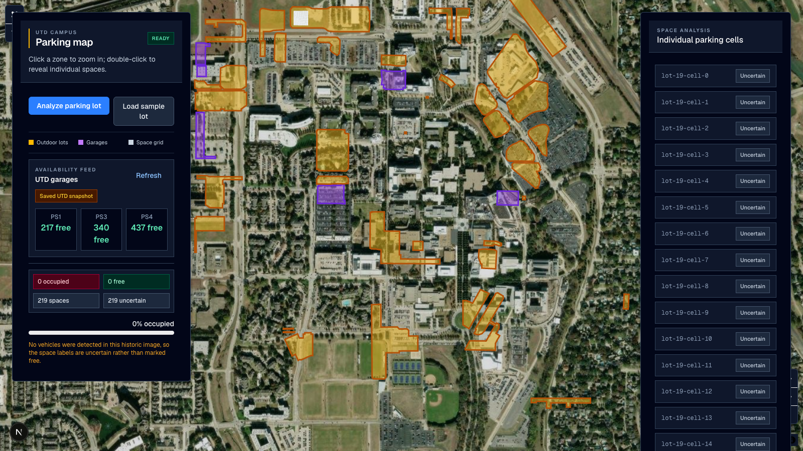
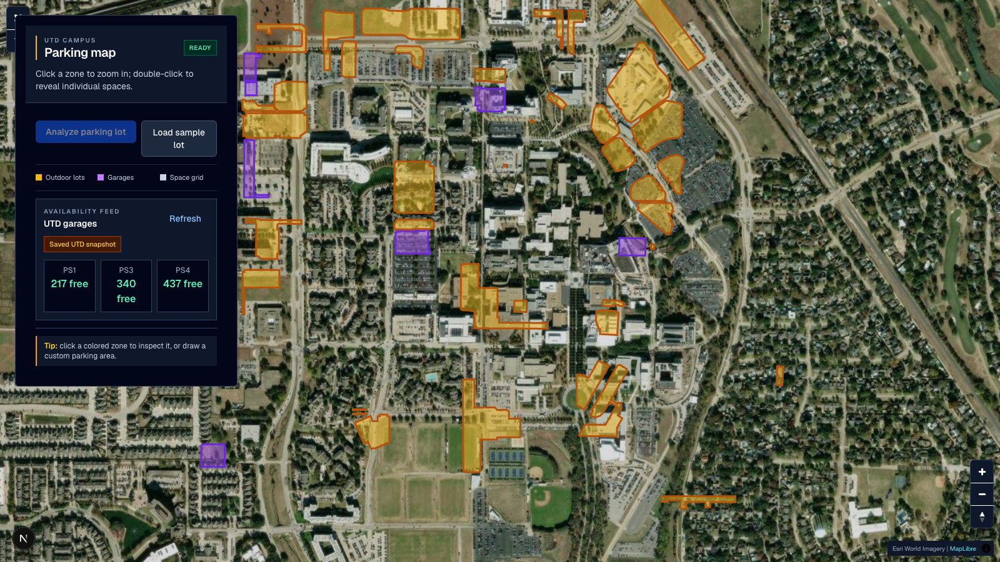
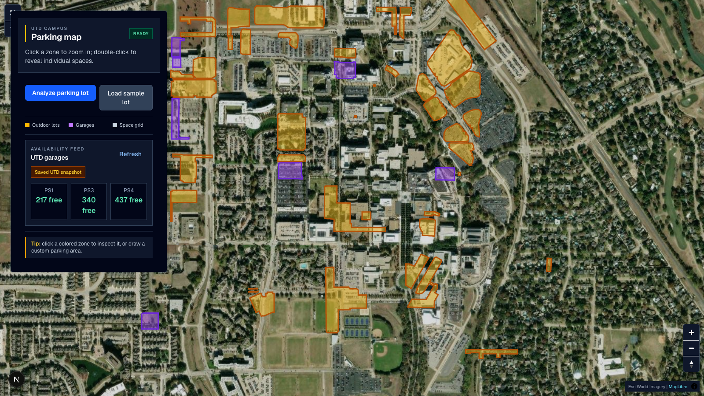
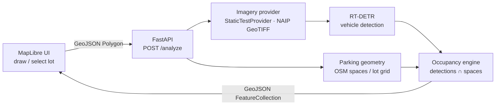

# Satellite Parking

Pick a parking area on a map. The app pulls overhead imagery, runs computer vision to find vehicles, and colors every parking space **occupied**, **free**, or **uncertain**.



## Final project data

Results of the November 19 MVP demonstration. Full write-up: [`absolute-docs/MVP_RESULTS.md`](absolute-docs/MVP_RESULTS.md).

| | |
| --- | --- |
| Lots analyzed | **1** sample lot |
| Imagery | Historical USGS NAIP aerial (4000 × 4000 px, ~0.66 m/px) |
| Grid cells processed | **219** |
| Processing time | **15.3 s** including initial model load |
| Vehicles detected | **0** |
| Cell classification | 0 occupied · 0 free · **219 uncertain** |
| Ground-truth labels / accuracy results | None yet |
| Live availability, rerouting, walking-time, time savings | Not yet validated |
| Accuracy ≥ 90% · false-open ≤ 2% | Proposed targets |

## Demo

| 1. Campus map | 2. Select a lot | 3. Analyze |
| --- | --- | --- |
|  |  |  |

- **Orange** zones are outdoor lots, **purple** are garages (64 mapped UTD parking areas).
- Click a zone to inspect it, double-click to reveal individual spaces, or draw a custom polygon.
- Result panel: occupied / free / uncertain counts, a per-cell list, and the UTD garage-availability feed (PS1, PS3, PS4) shown separately.

## How it works



1. The browser sends a GeoJSON polygon to `POST /analyze`.
2. The imagery provider returns the overhead raster; the polygon is converted to pixel space.
3. RT-DETR detects vehicles (car, truck, bus, motorcycle, bicycle).
4. Each parking space is intersected with detections (IoU > 0.1 or centroid containment) to decide occupied vs. free.
5. **No detections → every cell is `uncertain`**, never "free". A generic detector finding nothing is not proof a lot is empty.
6. The frontend renders red / green / gray polygons.

## Data

| Source | What | Where |
| --- | --- | --- |
| USGS NAIP Plus | Aerial GeoTIFF of the UTD campus, EPSG:3857 | `UTD-resources/utd_naip_plus.tif` |
| OpenStreetMap | 64 parking areas + 14 mapped spaces (cached); lots without mapped spaces are split into 4 m grid cells | `parking_geometry/data/` |
| UTD Parking Services | Public garage availability (PS1, PS3, PS4); labeled as a saved snapshot when the feed is offline | `UTD-resources/garage_availability.json` |
| RT-DETR | `PekingU/rtdetr_r50vd` from Hugging Face, threshold 0.3 | `vision/detector.py` |
| GAIA Lab UAV orthomosaic | 2.4 cm/px imagery, next-step data source | `UTD-resources/UAV_dataset_note.md` |

## Repository layout

```
backend/           FastAPI app: /analyze, /parking-lots, /garage-availability
frontend/          Next.js + MapLibre GL UI
vision/            Detector interface, RT-DETR and stub implementations
imagery/           ImageryProvider interface, StaticTestProvider
parking_geometry/  OSM loader, cached UTD lots and spaces
shared/            Coordinate transforms (WGS84 ↔ pixel), API schemas
UTD-resources/     Imagery, parking maps, garage feed, reference notes
absolute-docs/     Architecture, MVP, API, coordinates, roadmap, results
docs/screenshots/  Demo screenshots used in this README
```

## Run locally

Two terminals from the repository root.

```bash
# Terminal 1: API
python3 -m venv .venv
source .venv/bin/activate          # Windows: .\.venv\Scripts\Activate.ps1
pip install -r requirements.txt
python -m uvicorn backend.main:app --host 127.0.0.1 --port 8000
```

```bash
# Terminal 2: web app
cd frontend
npm install
npm run dev
```

Open <http://localhost:3000>, click **Load sample lot**, then **Analyze parking lot**. The first analysis downloads the detector model once; later runs use the local cache.

| Env var | Default | Purpose |
| --- | --- | --- |
| `TEST_IMAGE_PATH` | `UTD-resources/utd_naip_plus.tif` | Static test image |
| `MODEL_NAME` | `PekingU/rtdetr_r50vd` | Detection model |
| `DETECT_THRESHOLD` | `0.3` | Detection confidence cutoff |
| `SPOT_CELL_SIZE_M` | `4.0` | Grid cell size for lots without mapped spaces |
| `DETECTOR_BACKEND` | `rtdetr` | `stub` skips the model download for quick API tests |

## How we work

- **Docs first.** Design, MVP scope, tech stack and API contracts live in [`absolute-docs/`](absolute-docs/) and are written before the code that implements them.
- **Static image first.** The MVP isolates the risky parts, vision and coordinate math, behind a fixed image. Only after it is reliable do we swap the imagery source: static → latest aerial → Planet archive → Planet tasking. Vision, geometry and coordinate code stay unchanged across the swap.
- **Pluggable interfaces.** `ImageryProvider` and `Detector` are abstract, so providers and models change without touching the API or UI.
- **Small commits on `main`**, Conventional Commit style (`feat:`, `fix(frontend):`, `docs:`).
- **Measure before claiming.** Proposed targets (≥ 90% accuracy, ≤ 2% false-open) need a labeled ground-truth set before they are reported as results.

## Roadmap

1. Label ground truth for one lot and measure accuracy / false-open against the targets.
2. Higher-resolution imagery (GAIA UAV orthomosaic) so the detector can see individual cars.
3. Provider progression: latest aerial → Planet archive → Planet tasking.
4. Spot-level directions and fastest route to a free space.
5. SAM 2 masks, TiTiler for large rasters, caching and async jobs.

Details: [`ROADMAP.md`](absolute-docs/ROADMAP.md) · [`ARCHITECTURE.md`](absolute-docs/ARCHITECTURE.md) · [`MVP.md`](absolute-docs/MVP.md) · [`API.md`](absolute-docs/API.md) · [`TECH_STACK.md`](absolute-docs/TECH_STACK.md)
