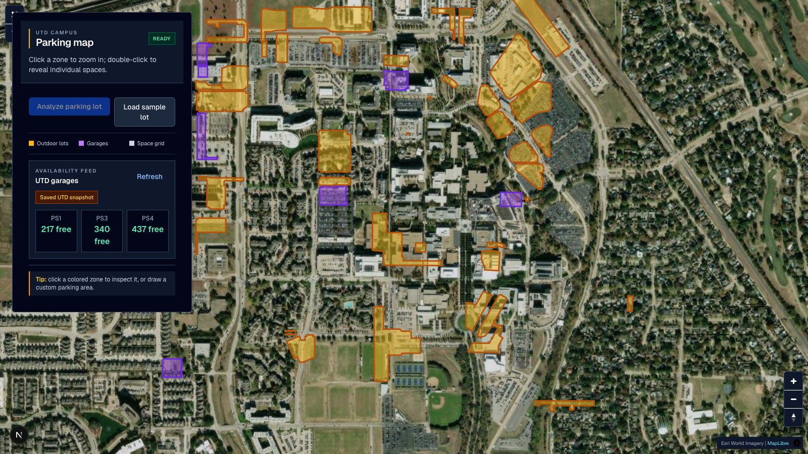
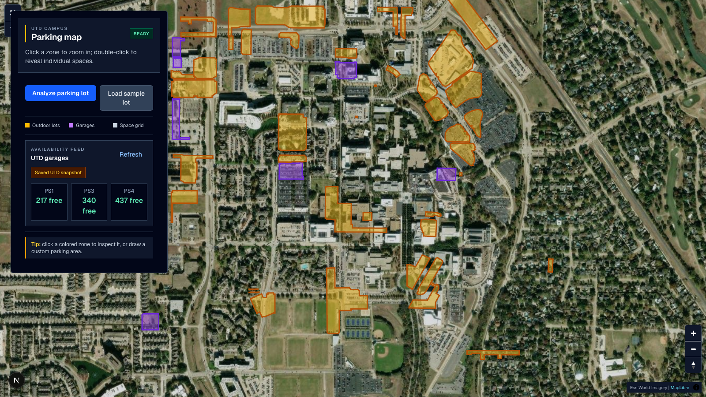
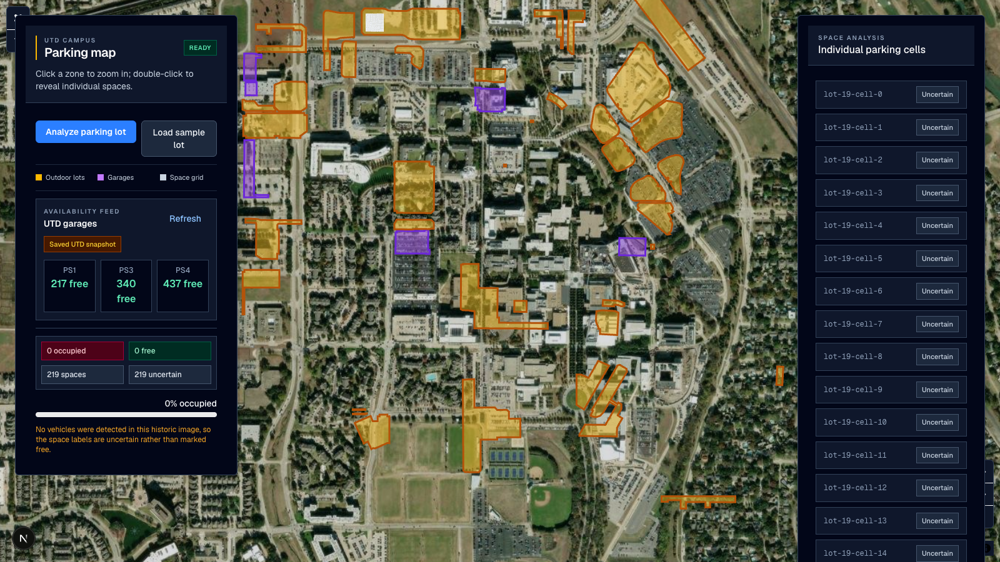

# MVP Test Results

Final project data from the MVP demonstration (November 19) of the static-image pipeline described in [`MVP.md`](MVP.md).

## Summary

| Metric | Result |
| --- | --- |
| Lots analyzed | 1 sample lot |
| Imagery | Historical USGS NAIP aerial image (`UTD-resources/utd_naip_plus.tif`, 4000 × 4000 px, ~0.66 m/px, EPSG:3857) |
| Grid cells analyzed | 219 |
| Processing time | 15.3 s, including initial model loading |
| Detector | RT-DETR (`PekingU/rtdetr_r50vd`), confidence threshold 0.3 |
| Vehicles detected | 0 |
| Cells classified occupied / free / uncertain | 0 / 0 / 219 |
| Ground-truth labels | None collected |
| Detection-accuracy results | None reported |

## Findings

1. **One sample lot was analyzed using historical aerial imagery.** The MVP runs against a single bundled NAIP image via `StaticTestProvider`; the API marks every response `imagery_is_current: false`.
2. **The prototype processed 219 grid cells in 15.3 seconds, including initial model loading.** The detector loads lazily on the first `/analyze` call, so the first request includes model load.
3. **Zero vehicles were detected, and all 219 cells were classified as uncertain.** With no detections, the occupancy engine returns `occupied: null` for every space instead of marking them free (`_is_occupied` in `backend/main.py`), and the map renders them gray.
4. **No ground-truth labels or formal detection-accuracy results are available.**
5. **Live parking availability, rerouting, walking-time accuracy, and actual time savings have not been validated.** Spot-level directions and fastest-route are post-MVP items in [`ROADMAP.md`](ROADMAP.md). The garage-availability panel is a separate UTD feed, not part of the vision pipeline.
6. **The ≥90% accuracy and ≤2% false-open thresholds are proposed targets, not achieved results.**

## Demonstration screenshots

| Campus map | Sample lot selected | Analysis result |
| --- | --- | --- |
|  |  |  |

The result screenshot shows the panel reading **219 spaces · 0 occupied · 0 free · 219 uncertain**, matching findings 2 and 3.

## Proposed validation targets

| Target | Value | Status |
| --- | --- | --- |
| Occupancy detection accuracy | ≥ 90% | Proposed |
| False-open rate (reported free, actually occupied) | ≤ 2% | Proposed |

## Next steps

- Label a ground-truth set for at least one lot so the targets can be measured.
- Move to higher-resolution imagery (GAIA UAV orthomosaic, 2.4 cm/px — see [`UAV_dataset_note.md`](../UTD-resources/UAV_dataset_note.md)) to give the detector visible vehicles.
- Then progress through the provider stages in [`MVP.md`](MVP.md): latest aerial → Planet archive → Planet tasking.
